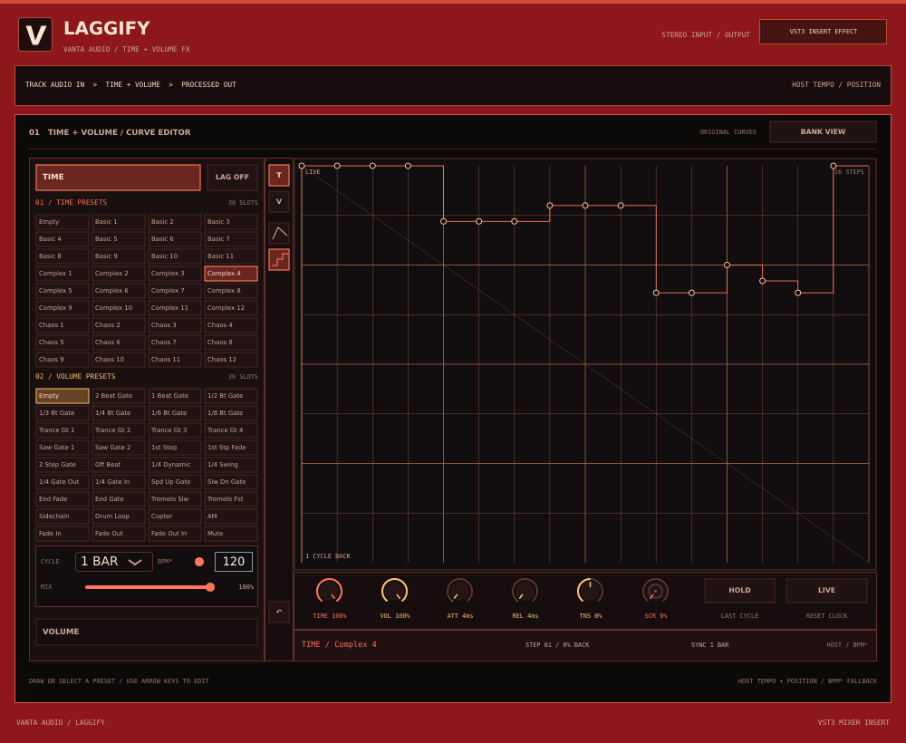

# Laggify 0.2 — separate mixer-insert effect

Laggify is an independent Windows x64 VST3 **audio effect**, not an instrument
and not a tab inside VANTA. Insert it on a mixer track or bus to process that
track's incoming mono or stereo audio. It has its own project, plugin ID,
installer and uninstaller. Installing or uninstalling it does not remove VANTA.



This is an off-screen native-editor test snapshot; fonts and host framing can
differ on Windows. The enlarged preset-bank view is shown
[here](docs/laggify-0.2-banks.png), and the size menu
[here](docs/laggify-0.2-resize.png).

Its time/volume sequencing is inspired by Gross Beat, but **is not a clone**.
Bank labels follow the requested visual reference; the 72 16-step example
curves were independently made. They are not Gross Beat's factory presets,
and Laggify does not import Gross Beat presets. Identical sound or behaviour is
not guaranteed. The approved [HTML concept](../design/laggify-ui-concept.html)
is a no-audio reference; the VST3 implements its own native editor.

## Install and use

1. Close your DAW. Download and run the separate, unsigned
   `Laggify-0.2-Setup.exe` from the **LAGGIFY 0.2 HERE** Windows workflow
   artifact. It installs `Laggify.vst3` to the standard system VST3 directory
   and adds a Windows uninstall entry. It uses the same plugin ID, install path
   and uninstaller identity as 0.1, so it updates that installation in place.
   Back up projects before trying betas.
2. Rescan plugins in FL Studio or another VST3 host. Load **Laggify** in an
   **effect slot on a mixer track**, not in the instrument/channel list. Route
   audio through that track and start at a low listening level.
3. Laggify initially passes audio through: click **LAG OFF** to enable it.
   Pick a **TIME** bank slot and a **VOLUME** bank slot independently. The
   example `Basic 1`, `Basic 6` and `Basic 11` slots demonstrate slower,
   reverse-like and stutter effects; `Sidechain` is a volume-pump pattern,
   not an external sidechain input. The 16-step grid approximates the fastest
   named rhythmic subdivisions. `Empty` resets the selected lane.
4. Click **TIME** or **VOLUME**, then drag across the large graph to edit its
   16 points. In the time graph, the top is live input and the bottom is one
   cycle of recorded audio back. In the volume graph, top is full gain and
   bottom is silence. The line and stair-step tools choose interpolated or
   held points for the active lane. Large drops in the time-back or gain value
   are held as retriggers rather than ramped, even in line mode. The graph also
   accepts left/right arrows to select a point and up/down arrows to change it.
   **BANK VIEW** hides the graph and enlarges the preset buttons; **SHOW GRAPH**
   returns to the editable curve.
5. Set **CYCLE** to half a bar, one bar or two bars, and use the main **MIX**
   for overall dry/wet balance. Cycles always mean 2, 4 or 8 quarter-note beats,
   irrespective of the host's time signature. The fallback **BPM*** is used
   only when the host supplies no valid tempo. Click the **V** logo for the
   centred size menu (60–150% or Fit Screen).
6. Use the separate **TIME** and **VOL** dials below the graph for the time
   effect and volume envelope amounts. Both range from 0–100%; the main MIX
   then blends the combined effect with the untouched input. Drag a dial up
   or down, use the mouse wheel or arrow keys, or double-click it to reset.
7. **ATT** (0–500 ms) and **REL** (0–1000 ms) set the volume-envelope rise and
   fall smoothing time constants; zero is immediate. **TNS** (−100% to +100%)
   bends interpolated volume segments and the smoothed transitions of stepped
   values. These are original approximations, not the Gross Beat algorithm.
8. Drag the **SCR** clock to scrub further back into the recent cycle; returning
   it toward zero moves forward through recorded history. It adds 0–100% of a
   cycle to the time curve, clamped to one cycle of history. Click **LIVE** or
   double-click the clock to reset the offset. Time mix at zero removes the
   audible scratch/time effect. Laggify cannot scrub into audio that has not
   arrived yet.
9. Toggle **HOLD** to repeat the latest complete recorded cycle while the
   effect is enabled. It is a latched, automatable toggle rather than a
   momentary button. HOLD works with both time and volume curves and the overall
   mix. If a complete fresh cycle has not arrived yet—including when opening a
   project with HOLD already on—it waits while normal processing continues. The
   frozen loop keeps its captured duration until HOLD is released; input history
   resumes recording after a brief release crossfade. A new hold waits for a
   fresh cycle after release. Host bypass releases the frozen buffer and passes
   audio through. HOLD can produce an infinite tail, so turn it off when
   appropriate for a render.

When the host is playing and supplies tempo and quarter-note position, Laggify
follows them; otherwise it runs a free clock and uses host tempo when available
or the fallback. Effect power, all mixes, cycle, interpolation, ATT/REL/TNS,
HOLD, scratch and all curve points are host-automatable. Curves, controls,
bank view and interface size are saved in the DAW project; the audio history
itself is not. New controls have neutral defaults when a 0.1 state is loaded.

The plugin records recent input while its own power is off, and during host
bypass if the host continues to send audio through it. Some hosts may stop
processing bypassed plugins. Laggify cannot play audio that has not yet
arrived, so reverse/rewind patterns may start with silence. On a transport jump
it uses the most recent input history rather than looking up the DAW timeline.
Jumps and gates are briefly smoothed, but extreme settings can still click or
sound unusual. Tempo is bounded to 30–400 BPM, and the history is capped at 16
seconds at 384 kHz.

Uninstall **Laggify 0.2** from Windows Settings or its Start Menu shortcut.
The uninstaller removes installed Laggify files, not VANTA, DAW projects or
extra files added by the user. Both installers are unsigned. Actual FL Studio,
audio-device and MIDI hardware behaviour still needs testing on Windows.

## Build and test on Windows

Install Visual Studio C++ tools, CMake 3.22+ and Inno Setup 6. The independent
project fetches pinned JUCE 8.0.6. From the repository root:

```powershell
cmake -S "Laggify VST Effect" -B build/laggify -A x64
cmake --build build/laggify --config Release --target LaggifyEngineTests LaggifyProcessorTests --parallel 2
cmake --build build/laggify --config Release --target LaggifyFx_VST3 LaggifyVST3Tests --parallel 2
ctest --test-dir build/laggify -C Release --output-on-failure
& "${env:ProgramFiles(x86)}\Inno Setup 6\ISCC.exe" "Laggify VST Effect/installer/Laggify.iss"
```

The independent workflow builds and tests DSP, processor/editor state and the
VST3 host contract. It then tests a 0.1-style installation upgraded in place,
uninstallation, bundle hashes and preservation on a disposable Windows runner.
The upgrade fixture uses the current binary with the previous version's
installer identity; it is not the archived 0.1 binary. Those checks are not a
replacement for testing in a real DAW. See
[third-party notices](THIRD_PARTY_NOTICES.md) and review licensing obligations
before distributing.
