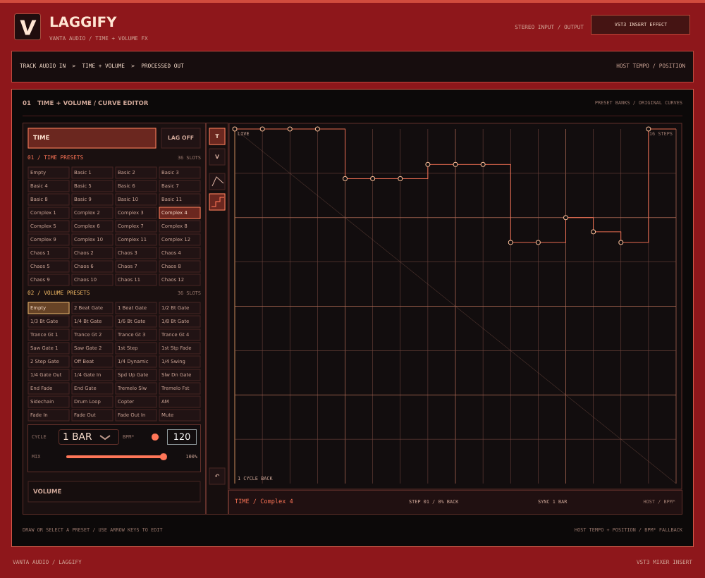

# Laggify 0.1 — separate mixer-insert effect

Laggify is an independent Windows x64 VST3 **audio effect**, not an instrument
and not a tab inside VANTA. Insert it on a mixer track or bus to process that
track's incoming mono or stereo audio. It has its own project, plugin ID,
installer and uninstaller. Installing or uninstalling it does not remove VANTA.



This is an off-screen native-editor test snapshot; fonts and host framing can
differ on Windows. The size menu is shown [here](docs/laggify-0.1-resize.png).

Its time/volume sequencing is inspired by Gross Beat, but **is not a clone**.
Bank labels follow the requested visual reference; the 72 16-step example
curves were independently made. They are not Gross Beat's factory presets,
and Laggify does not import Gross Beat presets. Identical sound or behaviour is
not guaranteed. The approved [HTML concept](../design/laggify-ui-concept.html)
is a no-audio reference; the VST3 implements its own native editor.

## Install and use

1. Close your DAW. Download and run the separate, unsigned
   `Laggify-0.1-Setup.exe` from the **LAGGIFY 0.1 HERE** Windows workflow
   artifact. It installs `Laggify.vst3` to the standard system VST3 directory
   and adds a Windows uninstall entry. Back up projects before trying betas.
2. Rescan plugins in FL Studio or another VST3 host. Load **Laggify** in an
   **effect slot on a mixer track**, not in the instrument/channel list. Route
   audio through that track and start at a low listening level.
3. Laggify initially passes audio through: click **LAG OFF** to enable it.
   Pick a **TIME** bank slot and a **VOLUME** bank slot independently. The
   example `Basic 1`, `Basic 6` and `Basic 11` slots demonstrate slower,
   reverse-like and stutter effects; `Sidechain` is a volume-pump pattern,
   not an external sidechain input. The 16-step grid approximates the fastest
   named rhythmic subdivisions. `Empty` resets the selected lane.
4. Click **TIME** or **VOLUME**, then drag across the large graph to edit its
   16 points. In the time graph, the top is live input and the bottom is one
   cycle of recorded audio back. In the volume graph, top is full gain and
   bottom is silence. The line and stair-step tools choose interpolated or
   held points for the active lane. Large drops in the time-back or gain value
   are held as retriggers rather than ramped, even in line mode. The graph also
   accepts left/right arrows to select a point and up/down arrows to change it.
5. Set **CYCLE** to half a bar, one bar or two bars, and use **MIX** for
   dry/wet balance. For this first version, these cycles always mean 2, 4 or
   8 quarter-note beats, irrespective of the host's time signature. The
   fallback **BPM*** is used only when the host supplies no valid tempo.
   Click the **V** logo for the centred size menu (60–150% or Fit Screen).

When the host is playing and supplies tempo and quarter-note position, Laggify
follows them; otherwise it runs a free clock and uses host tempo when available
or the fallback. Effect power, mix, cycle, interpolation and all curve points
are host-automatable; curves and interface size are saved in the DAW project.
The plugin records recent input while its own power is off, and during host
bypass if the host continues to send audio through it. Some hosts may stop
processing bypassed plugins. Laggify cannot play audio that has not yet
arrived, so reverse/rewind patterns may start with silence. On a transport jump
it uses the most recent input history rather than looking up the DAW timeline. Jumps and gates are
briefly smoothed, but extreme settings can still click or sound unusual. Tempo
is bounded to 30–400 BPM, and the history is capped at 16 seconds at 384 kHz.

Uninstall **Laggify 0.1** from Windows Settings or its Start Menu shortcut.
The uninstaller removes installed Laggify files, not VANTA, DAW projects or
extra files added by the user. Both installers are unsigned. Actual FL Studio,
audio-device and MIDI hardware behaviour still needs testing on Windows.

## Build and test on Windows

Install Visual Studio C++ tools, CMake 3.22+ and Inno Setup 6. The independent
project fetches pinned JUCE 8.0.6. From the repository root:

```powershell
cmake -S "Laggify VST Effect" -B build/laggify -A x64
cmake --build build/laggify --config Release --target LaggifyEngineTests LaggifyProcessorTests --parallel 2
cmake --build build/laggify --config Release --target LaggifyFx_VST3 LaggifyVST3Tests --parallel 2
ctest --test-dir build/laggify -C Release --output-on-failure
& "${env:ProgramFiles(x86)}\Inno Setup 6\ISCC.exe" "Laggify VST Effect/installer/Laggify.iss"
```

The independent workflow builds and tests DSP, processor/editor state and the
VST3 host contract, then tests installation, uninstallation and preservation
on a disposable Windows runner. Those checks are not a replacement for testing
in a real DAW. See [third-party notices](THIRD_PARTY_NOTICES.md) and review
licensing obligations before distributing.
