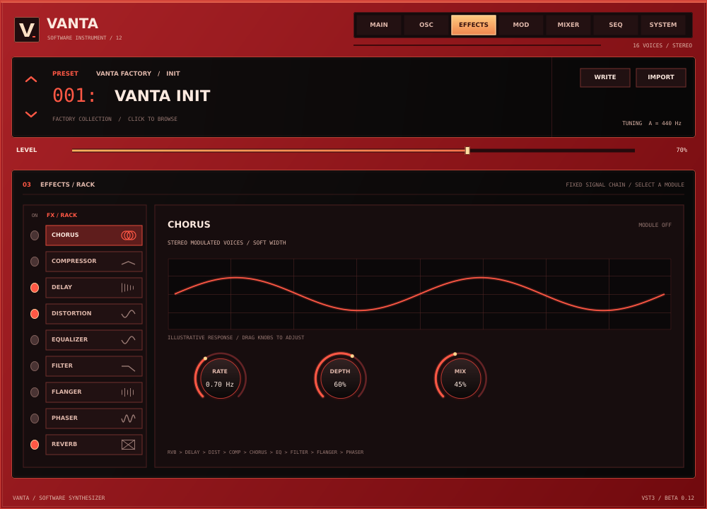

# Vanta Beta 0.12

VANTA is an experimental Windows x64 instrument, available as a VST3 for FL Studio and other hosts and as a standalone application. Beta 0.12 expands the nine-module effects rack. **Laggify** is a separate VST3 mixer-insert effect, not a synth tab or a standalone instrument. It retains the uninstaller, resize menu and **experimental, partial preset conversion** for Vital, Serum 1 and Serum 2. Converted sounds are approximations, not sound-for-sound reproductions.



View the [resize menu](docs/vanta-beta-0.10-resize-menu.png), [main editor](docs/vanta-beta-0.10-vst-main.png) or [oscillator page](docs/vanta-beta-0.10-vst-oscillators.png). These are off-screen native-editor test snapshots; fonts and host framing may differ on Windows. The [Laggify HTML](design/laggify-ui-concept.html) is a no-audio design concept.

## Install and play

The Windows build produces `Vanta-Beta-0.12-Setup.exe`, a standalone application and a VST3 bundle. The installer is unsigned. **Back up DAW projects and close FL Studio and other audio programs before installing.** The betas share a VST3 ID, so duplicate copies can confuse a plugin scan.

Setup checks the standard Windows VST3 folder for exact `Vanta Beta 0.1.vst3` through `Vanta Beta 0.11.vst3` names. You can also choose one additional VST3 folder. It shows the detected copies and defaults to **Remove the older VANTA plugin copies**; untick that option if you want to keep them. Cleanup happens only after the new app and VST3 have installed. It removes recognised old plugin binaries and their generated metadata, while keeping other files, including projects and presets even if they were placed inside a plugin folder. Beta 0.12 and future versions are not targeted. Linked/junction and unrecognised layouts are not followed or recursively deleted; some unusual or renamed copies may require manual removal.

The cleanup does **not** search the entire computer, remove renamed/manual copies in other folders, or uninstall older standalone apps and their Windows Settings entries. Select a custom VST3 folder during setup if needed, or remove other copies manually; older standalone apps can be removed individually from Windows Settings. Setup and uninstall stop if the current app or standard VST3 location is linked, inaccessible, or has unexpected files in place of installed files. Close the DAW and retry if a plugin is in use. Rescan plugins in FL Studio after installation.

Launch **Vanta > Vanta Beta 0.12** from the Start Menu. In the standalone window choose **Options > Audio/MIDI Settings...** to select an audio output and enable a MIDI input. Start with a low output volume. Click the on-screen keys, or focus the keyboard and play:

`Q 2 W 3 E R 5 T 6 Y 7 U I 9 O 0 P`

These keys span C4–E5. The VST3 receives MIDI from the host; the standalone keyboard does not inject notes into a VST3 instance.

### Uninstall VANTA

Open **Start > Vanta > Uninstall Vanta Beta 0.12**, or use **Settings > Apps > Installed apps > Vanta Beta 0.12 > Uninstall**. The uninstaller removes this beta's installed standalone app, VST3 files and shortcuts. It can also check one additional VST3 folder and asks whether to remove recognised older plugin copies; choosing no leaves them alone. Projects, presets, extra files and earlier standalone apps are not deleted. A folder with extra user files may remain after its plugin binary is removed. If a folder is a link/junction or has an unrecognised layout, it is not automatically removed. Manually copied or renamed files outside the selected folders are not discovered.

For unattended deployment, silent setup and uninstall **do not remove old plugin copies by default**. Explicitly add `/REMOVEOLDVANTA` to opt in and optionally `/VANTASCANDIR="C:\path\to\VST3"` to include one additional existing, non-linked folder. Add `/LOG="C:\path\to\vanta.log"` to capture details. If requested setup cleanup is incomplete, setup returns exit code `20` after installing the new version; close the DAW or resolve the reported path and retry. Silent uninstallation reports cleanup problems in its log. These options remove old plugin files, not older standalone apps or registry entries.

### Resize the interface

Click the **V** logo at the upper left to open the centred size menu. Choose **60%, 75%, 90%, 100%, 110%, 125% or 150%**, or **FIT SCREEN** to estimate a size for the current monitor. Escape, the close button, or a click outside dismisses the menu. The whole interface, including the standalone keyboard and mouse targets, scales together. The selection is stored in the host's project state and the standalone's saved state, not in individual presets; older projects default to 100%.

VST3 resizing depends on the host accepting the requested window size. If the host does not accept it, VANTA returns to the available size and reopens the menu with a warning. If the window extends beyond a monitor, the menu tries to stay centred in the visible portion. The minimum is 60%; Fit Screen reserves some space for window borders but may not fit on very small displays. Actual resizing and display scaling in FL Studio have not yet been verified.

## Effects rack

Open **EFFECTS**, select a module on the left and click its small power light to switch it on or off. The rack includes chorus, compressor (VANTA's three-band dynamics), delay, distortion, three-band EQ, post-effects low-pass filter, flanger, phaser and reverb. Drag the knobs to change their settings. The graph is an illustrative parameter view, not a live measurement. The chain order is fixed: reverb → delay → distortion → compressor → chorus → EQ → filter → flanger → phaser.

The three original effects keep their previous mix settings and default to enabled for compatibility with older projects; their default mix is zero. The newly added modules default to off. Values are saved with VANTA presets and host projects.

## Separate Laggify effect

Laggify is an independent VST3 **mixer insert**, built from [`Laggify VST Effect`](Laggify%20VST%20Effect/README.md) with its own installer and download. It processes the audio of whichever mixer track or bus you put it on, not just VANTA. It is not inside the VANTA instrument. See the [Laggify guide](Laggify%20VST%20Effect/README.md) for controls, sync and limitations.

## Importing presets

Click **IMPORT** above the editor and choose a `.vanta`, `.vital`, Serum 1 `.fxp` or Serum 2 `.SerumPreset` file. VANTA decodes the file on a worker thread and applies a successful result on the message thread. Read the conversion warnings: features that cannot be translated may be substituted, disabled or omitted. A rejected file leaves the current patch unchanged. Use **WRITE** to save an imported result as a `.vanta` file; supported tables, the sample and imported modulation are stored in the preset and host state.

- **Vital:** Imports a subset of oscillator settings and embedded Wave Source keyframes, one embedded sample, amplitude ADSR, filter-1 cutoff and selected LFO-to-oscillator routes.
- **Serum 1:** Reads supported VST2 `CcnK`/`FPCh` Serum preset containers, selected parameter layouts, embedded wavetable/noise data, amplitude ADSR and selected LFO routes. Other FXP formats and unrecognised Serum versions are rejected. Testing includes synthetic files and a few real presets, not a broad library of commercial presets.
- **Serum 2:** Reads supported `XferJson`/zstd/CBOR containers, selected oscillator and envelope parameters, supported embedded wavetable/noise arrays and LFO routes. External tables or samples are **not loaded**: VANTA substitutes a basic oscillator or disables the missing sample and warns. Granular, spectral and multisample engines are not implemented. Testing includes synthetic files and one real init preset, not a broad preset library.
- **ZENOLOGY `.svz` / `.svd` / `.bin`:** Not supported.

There are important limits: eight oscillator slots, 16 stored frames per table, one sample of at most 262,144 frames, four imported LFOs and 32 routes per patch. Oversized source tables/samples are reduced with warnings; unsupported routes and warps are dropped with warnings. Imported table playback is not band-limited and may alias at high notes. LFO timing, curves and modulation amounts are approximate; the editor does not yet edit imported LFO routes. Non-multiband effects, filter models, unison and many other source-specific features are not translated. The source and converted presets can therefore sound substantially different; some patches may be silent if an unsupported envelope or other source controls all layer levels. In that case VANTA warns and you can raise a layer level manually.

When a supported source multiband compressor is active, VANTA enables its **own** three-band upward/downward dynamics approximation, with +3 dB high-band compensation and approximate depth/mix. It is not an exact Xfer or Vital OTT emulation; inactive or unrecognised compression stays bypassed. Control it on the **EFFECTS** page. Use the **OSC** page to select an available imported wavetable/sample and adjust table position. **MIXER** can enable or disable OSC A–H, including A for imported patches.

Only import files you trust. Files over 32 MB and malformed/unsupported structures are rejected; decompression, nesting and asset sizes are bounded. The importer does not resolve external file paths. No third-party preset banks, wavetables or samples are included. File reading and conversion are outside the audio callback; host state serialization/restoration is synchronous when requested by the host.

## Other features and limits

- Up to eight layered sine, saw, square or triangle oscillators per note, with level, tuning and pan. The OSC page's **+ NEW TAB** enables layers. Imported wavetable frames and one PCM sample can also play through these layers. All layers share one low-pass filter, amplitude envelope and effects chain.
- Sixteen-voice polyphony, MIDI velocity, sustain and ±2-semitone pitch bend; shared ADSR, sine pitch vibrato, nine effects modules. The separate Laggify insert is not part of the synth signal chain. The **MAIN**, **OSC**, **EFFECTS** and **MOD** plots illustrate settings, not live audio.
- Five factory sounds, a searchable browser and native `.vanta` save/load. The **SEQ** page is a non-playable design preview. Editable general modulation, macros, per-layer filters/envelopes, unison and many planned effects remain unimplemented. See [the roadmap](design/windows-feature-roadmap.md).

Existing plugin and parameter IDs are retained. OSC A's original two-choice `wave` parameter remains compatible with earlier automation; newer features use appended IDs. Old presets and host state default new layers off. Automated migration checks pass, but **FL Studio project migration and physical audio/MIDI testing remain unverified**; keep backups.

## Build and test on Windows

The VANTA GitHub Actions workflow builds the VST3 and standalone, runs engine/effects/importer/editor tests and an off-screen VST3 host-view resize/DPI test, creates the installer, and tests consent, duplicate cleanup, custom folders, preserved data, locked files, junctions, reinstall, standalone launch, shortcuts and uninstall on disposable Windows runners. It does **not** test a real audio device, MIDI hardware or FL Studio. A separate workflow builds and tests the independent Laggify installer.

For a local build, install Visual Studio C++ tools, CMake 3.22+ and Inno Setup 6. Configuration fetches pinned JUCE 8.0.6, zlib 1.3.1 and Zstandard 1.5.6 sources.

```powershell
cmake -S . -B build -A x64
cmake --build build --config Release --target VantaTests --parallel
cmake --build build --config Release --target VantaEffectsTests --parallel
cmake --build build --config Release --target VantaImporterTests --parallel
cmake --build build --config Release --target VantaEditorTests --parallel
cmake --build build --config Release --target VantaBeta_VST3 --parallel
cmake --build build --config Release --target VantaVST3Tests --parallel
ctest --test-dir build -C Release --output-on-failure
cmake --build build --config Release --target VantaBeta_Standalone --parallel
& "${env:ProgramFiles(x86)}\Inno Setup 6\ISCC.exe" installer.iss
```

The installer defaults to `C:\Program Files\Vanta\Vanta Beta 0.12` and the standard `C:\Program Files\Common Files\VST3` folder. After installing, test audio/MIDI devices, import/save/reopen and DAW project restoration at low volume. See [third-party notices](THIRD_PARTY_NOTICES.md) and review JUCE licensing obligations before distribution.
