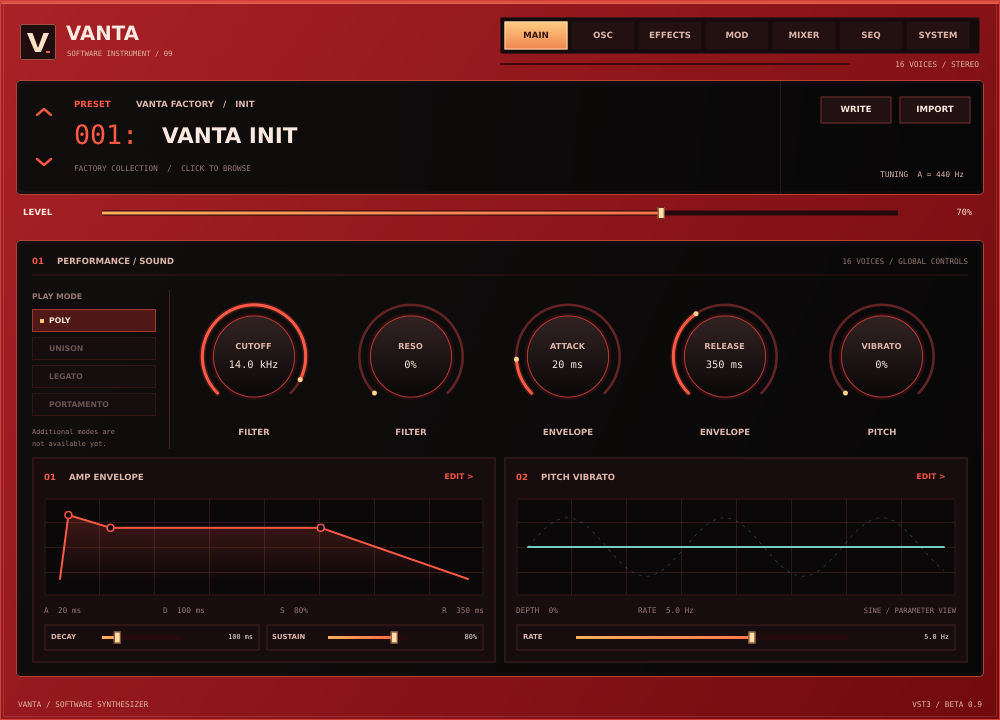

# Vanta Beta 0.9

VANTA is an experimental Windows x64 instrument, available as a VST3 for FL Studio and other hosts and as a standalone application. Beta 0.9 redesigns the native editor to follow the approved HTML concept more closely, while retaining Beta 0.8’s **experimental, partial preset conversion** for Vital, Serum 1 and Serum 2, imported audio sources and a three-band dynamics effect. Converted sounds are approximations, not sound-for-sound reproductions.



[View the native oscillator page](docs/vanta-beta-0.9-vst-oscillators.png) or [standalone keyboard](docs/vanta-beta-0.9-standalone.png). These are off-screen native-editor test snapshots; fonts and host framing may differ on Windows. The HTML is a design concept, so planned controls and long roadmap sections are not falsely presented as working synth features.

## Install and play

The Windows build produces `Vanta-Beta-0.9-Setup.exe`, a standalone application and a VST3 bundle. The installer is unsigned. **Back up DAW projects and uninstall earlier VANTA betas before installing:** the betas share a VST3 ID, and duplicate bundles can confuse a plugin scan. Rescan plugins in FL Studio after installation.

Launch **Vanta > Vanta Beta 0.9** from the Start Menu. In the standalone window choose **Options > Audio/MIDI Settings...** to select an audio output and enable a MIDI input. Start with a low output volume. Click the on-screen keys, or focus the keyboard and play:

`Q 2 W 3 E R 5 T 6 Y 7 U I 9 O 0 P`

These keys span C4–E5. The VST3 receives MIDI from the host; the standalone keyboard does not inject notes into a VST3 instance.

## Importing presets

Click **IMPORT** above the editor and choose a `.vanta`, `.vital`, Serum 1 `.fxp` or Serum 2 `.SerumPreset` file. VANTA decodes the file on a worker thread and applies a successful result on the message thread. Read the conversion warnings: features that cannot be translated may be substituted, disabled or omitted. A rejected file leaves the current patch unchanged. Use **WRITE** to save an imported result as a `.vanta` file; supported tables, the sample and imported modulation are stored in the preset and host state.

- **Vital:** Imports a subset of oscillator settings and embedded Wave Source keyframes, one embedded sample, amplitude ADSR, filter-1 cutoff and selected LFO-to-oscillator routes.
- **Serum 1:** Reads supported VST2 `CcnK`/`FPCh` Serum preset containers, selected parameter layouts, embedded wavetable/noise data, amplitude ADSR and selected LFO routes. Other FXP formats and unrecognised Serum versions are rejected. Testing includes synthetic files and a few real presets, not a broad library of commercial presets.
- **Serum 2:** Reads supported `XferJson`/zstd/CBOR containers, selected oscillator and envelope parameters, supported embedded wavetable/noise arrays and LFO routes. External tables or samples are **not loaded**: VANTA substitutes a basic oscillator or disables the missing sample and warns. Granular, spectral and multisample engines are not implemented. Testing includes synthetic files and one real init preset, not a broad preset library.
- **ZENOLOGY `.svz` / `.svd` / `.bin`:** Not supported.

There are important limits: eight oscillator slots, 16 stored frames per table, one sample of at most 262,144 frames, four imported LFOs and 32 routes per patch. Oversized source tables/samples are reduced with warnings; unsupported routes and warps are dropped with warnings. Imported table playback is not band-limited and may alias at high notes. LFO timing, curves and modulation amounts are approximate; the editor does not yet edit imported LFO routes. Non-multiband effects, filter models, unison and many other source-specific features are not translated. The source and converted presets can therefore sound substantially different; some patches may be silent if an unsupported envelope or other source controls all layer levels. In that case VANTA warns and you can raise a layer level manually.

When a supported source multiband compressor is active, VANTA enables its **own** three-band upward/downward dynamics approximation, with +3 dB high-band compensation and approximate depth/mix. It is not an exact Xfer or Vital OTT emulation; inactive or unrecognised compression stays bypassed. Control it on the **EFFECTS** page. Use the **OSC** page to select an available imported wavetable/sample and adjust table position. **MIXER** can enable or disable OSC A–H, including A for imported patches.

Only import files you trust. Files over 32 MB and malformed/unsupported structures are rejected; decompression, nesting and asset sizes are bounded. The importer does not resolve external file paths. No third-party preset banks, wavetables or samples are included. File reading and conversion are outside the audio callback; host state serialization/restoration is synchronous when requested by the host.

## Other features and limits

- Up to eight layered sine, saw, square or triangle oscillators per note, with level, tuning and pan. The OSC page's **+ NEW TAB** enables layers. Imported wavetable frames and one PCM sample can also play through these layers. All layers share one low-pass filter, amplitude envelope and effects chain.
- Sixteen-voice polyphony, MIDI velocity, sustain and ±2-semitone pitch bend; shared ADSR, sine pitch vibrato, reverb, delay and distortion. The **MAIN**, **OSC**, **EFFECTS** and **MOD** plots illustrate settings, not live audio.
- Five factory sounds, a searchable browser and native `.vanta` save/load. The **SEQ** page is a non-playable design preview. Editable general modulation, macros, per-layer filters/envelopes, unison and many planned effects remain unimplemented. See [the roadmap](design/windows-feature-roadmap.md).

Existing plugin and parameter IDs are retained. OSC A's original two-choice `wave` parameter remains compatible with earlier automation; newer features use appended IDs. Old presets and host state default new layers off. Automated migration checks pass, but **FL Studio project migration and physical audio/MIDI testing remain unverified**; keep backups.

## Build and test on Windows

The GitHub Actions workflow builds the VST3 and standalone, runs engine/importer/editor tests, creates the installer, and smoke-tests install, standalone launch, shortcut and uninstall on a disposable Windows runner. It does **not** test a real audio device, MIDI hardware or FL Studio.

For a local build, install Visual Studio C++ tools, CMake 3.22+ and Inno Setup 6. Configuration fetches pinned JUCE 8.0.6, zlib 1.3.1 and Zstandard 1.5.6 sources.

```powershell
cmake -S . -B build -A x64
cmake --build build --config Release --target VantaTests --parallel
cmake --build build --config Release --target VantaImporterTests --parallel
cmake --build build --config Release --target VantaEditorTests --parallel
ctest --test-dir build -C Release --output-on-failure
cmake --build build --config Release --target VantaBeta_VST3 --parallel
cmake --build build --config Release --target VantaBeta_Standalone --parallel
& "${env:ProgramFiles(x86)}\Inno Setup 6\ISCC.exe" installer.iss
```

The installer defaults to `C:\Program Files\Vanta\Vanta Beta 0.9` and the standard `C:\Program Files\Common Files\VST3` folder. Uninstall removes this beta's app, plugin and shortcut, not saved presets. After installing, test audio/MIDI devices, import/save/reopen and DAW project restoration at low volume. See [third-party notices](THIRD_PARTY_NOTICES.md) and review JUCE licensing obligations before distribution.
