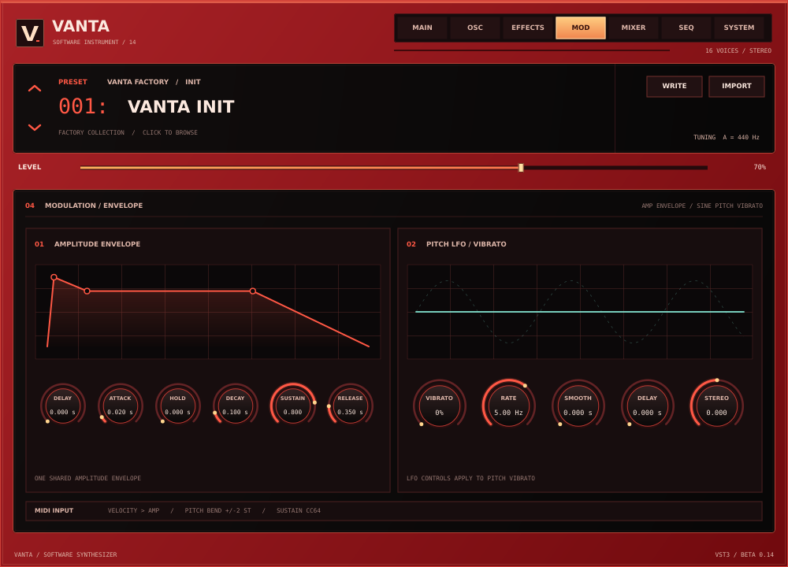

# Vanta Beta 0.14

VANTA is an experimental Windows x64 instrument, available as a VST3 and standalone application. VANTA Suite also includes **Laggify** and **VANTA Sidechain** as independent mixer-insert VST3 effects. Beta 0.14 adds the requested envelope, pitch-LFO and oscillator ranges while retaining the resize menu and **experimental, partial preset conversion** for Vital, Serum 1 and Serum 2. These controls and conversions are VANTA approximations, not sound-for-sound Vital reproductions.

**Suite 0.15.0 Windows installer:** [Download VANTA SUITE HERE](https://github.com/PAGE404MAX/Vanta-0.1/actions/runs/42319172173/artifacts/13552059125). Includes VANTA Beta 0.14 with saw INIT, Laggify 0.2, Sidechain 0.1, and the new **VANTA FX 0.1 development prototype**. FX now uses the original approved nine-tab crimson/black design, draggable knobs, real waveform/spectrum/stereo-space views, and a tested native stereo Delay engine. The browser audio-tester UI is not embedded. Other effect algorithms/advanced controls remain in development. See [FX status](VANTA%20FX/README.md). All build, FX editor/state, installer, uninstall and published-0.13.2-upgrade checks passed in [run 42319172173](https://github.com/PAGE404MAX/Vanta-0.1/actions/runs/42319172173). Installer unsigned; FL Studio and physical audio/MIDI still require manual verification.



[View the Beta 0.12 effects rack](docs/vanta-beta-0.12-effects.png).

View the [resize menu](docs/vanta-beta-0.10-resize-menu.png), [main editor](docs/vanta-beta-0.10-vst-main.png) or [Beta 0.14 oscillator page](docs/vanta-beta-0.14-oscillator.png). These are off-screen native-editor test snapshots; fonts and host framing may differ on Windows. The [Laggify HTML](design/laggify-ui-concept.html) is a no-audio design concept.

## Install the suite

Download **VANTA SUITE HERE** from the successful Windows suite build and run `Vanta-Suite-Setup.exe`. This single unsigned setup wizard installs VANTA Beta 0.14 (VST3 and standalone), Laggify 0.2 (VST3), VANTA Sidechain 0.1 (VST3), and VANTA FX 0.1 development (VST3). **Back up DAW projects and close FL Studio and other audio programs first.** Windows may warn because the installer is unsigned; rescan plugins after installation.

VANTA 0.13 and suite 0.13.1 are intended to upgrade in place, retaining the synth's plugin/parameter IDs; the exact published suite 0.13.2 files were verified and the upgrade test passed. The installer refuses to overwrite unverified replacements. Choose the same app folder during setup; moving it would leave an old uninstaller behind. If the separate Laggify installer is registered, the suite stops rather than take over a VST3 still owned by a second uninstaller. Uninstall the old separate Laggify through Windows Settings first, then run the suite setup. Your DAW projects and presets are not removed. If the wizard detects a manually installed current VANTA, Laggify or Sidechain VST3, or a conflicting suite-named app file, back it up and move it aside before retrying; it will not silently overwrite it. Don't run an old VANTA 0.13 or separate Laggify installer over the suite. The newer VANTA-only setup stops when it detects an existing suite. If an older separate installer was run over the suite, remove the conflicting separate copy and repair the suite before uninstalling the suite.

### Uninstall the suite

Open **Start > Vanta > Uninstall Vanta Suite**, or **Settings > Apps > Installed apps > VANTA Suite > Uninstall**. The first question asks **“Uninstall any old VANTA VSTs?”** Select Yes to scan and review recognised older VANTA copies or No to keep them. The normal suite-uninstall confirmation follows; cancelling it removes nothing. One uninstaller removes the suite's installed VANTA standalone, all four VST3 bundles, and shortcuts. Projects, user presets, other plugins and unknown files are retained; a plugin folder may remain if it contains additional files. A linked/junction or inaccessible installation path stops setup/uninstall rather than being traversed. The setup and uninstaller also stop if a suite-installed file, including a plugin, manifest, executable, marker or included documentation, has been replaced or modified; back up and move the changed file aside before retrying. Existing, separate older VANTA standalone entries are left alone. Reinstall/repair the suite if an old uninstaller removed a suite file.

### Use VANTA Sidechain

Put **VANTA Sidechain** on the destination (for example, bass) mixer track. In FL Studio, select the kick track, right-click the bass track's send arrow and choose **Sidechain to this track**. In the wrapper's **Settings → Processing**, map the external Sidechain input if needed; select **VOLUME → SIDECHAIN** in the effect and lower the threshold until the kick triggers it. See the [Sidechain guide](Sidechain%20VST%20Effect/README.md) for its 12 effects, multiband curves, STEP DRAW, MIDI and sync. FL Studio itself has not yet been verified.

## VANTA install and play details

The original VANTA-only Windows build also produces `Vanta-Beta-0.14-Setup.exe`, a standalone application and a VST3 bundle. The betas share a VST3 ID, so duplicate copies can confuse a plugin scan. For in-place compatibility the Beta 0.14 binary, bundle and Start Menu shortcut intentionally retain their **Vanta Beta 0.13** filesystem names; the VST3 host and editor identify the running instrument as Beta 0.14.

The first setup prompt asks **“Uninstall any old VANTA VSTs?”** Choose Yes to scan the standard Windows VST3 folder for exact `Vanta Beta 0.1.vst3` through `Vanta Beta 0.12.vst3` names. The results window lists each detected path, offers an optional additional folder and lets you choose **Remove listed VSTs** or **Keep / Continue**. Choose No at the first prompt to skip the scan and keep old copies. Cleanup happens only after the new app and VST3 have installed. It removes recognised old plugin binaries and their generated metadata, while keeping other files, including projects and presets even if they were placed inside a plugin folder. The active `Vanta Beta 0.13.vst3` path (also used by Beta 0.14) and future versions are not targeted. Linked/junction and unrecognised layouts are not followed or recursively deleted; some unusual or renamed copies may require manual removal.

The cleanup does **not** search the entire computer, remove renamed/manual copies in other folders, or uninstall older standalone apps and their Windows Settings entries. Select a custom VST3 folder during setup if needed, or remove other copies manually; older standalone apps can be removed individually from Windows Settings. Setup and uninstall stop if the current app or standard VST3 location is linked, inaccessible, or has unexpected files in place of installed files. Close the DAW and retry if a plugin is in use. Rescan plugins in FL Studio after installation.

Launch **Vanta > Vanta Beta 0.13** from the Start Menu. In the standalone window choose **Options > Audio/MIDI Settings...** to select an audio output and enable a MIDI input. Start with a low output volume. Click the on-screen keys, or focus the keyboard and play:

`Q 2 W 3 E R 5 T 6 Y 7 U I 9 O 0 P`

These keys span C4–E5. The VST3 receives MIDI from the host; the standalone keyboard does not inject notes into a VST3 instance.

### Uninstall the older VANTA-only setup

If you installed the older VANTA-only setup rather than the suite, open **Start > Vanta > Uninstall Vanta Beta 0.13**, or use **Settings > Apps > Installed apps > Vanta Beta 0.14 > Uninstall**. The uninstaller removes this beta's installed standalone app, VST3 files and shortcuts. It first asks whether to find old VANTA VSTs; choosing Yes shows the recognised copies, with an optional additional VST3 folder. Choosing No or Keep leaves old copies alone. Projects, presets, extra files and earlier standalone apps are not deleted. A folder with extra user files may remain after its plugin binary is removed. If a folder is a link/junction or has an unrecognised layout, it is not automatically removed. Manually copied or renamed files outside the selected folders are not discovered.

For unattended deployment, silent setup and uninstall **do not remove old plugin copies by default**. Explicitly add `/REMOVEOLDVANTA` to opt in and optionally `/VANTASCANDIR="C:\path\to\VST3"` to include one additional existing, non-linked folder. Add `/LOG="C:\path\to\vanta.log"` to capture details. If requested setup cleanup is incomplete, setup returns exit code `20` after installing the new version; close the DAW or resolve the reported path and retry. Silent uninstallation reports cleanup problems in its log. These options remove old plugin files, not older standalone apps or registry entries.

### Resize the interface

Click the **V** logo at the upper left to open the centred size menu. Choose **60%, 75%, 90%, 100%, 110%, 125% or 150%**, or **FIT SCREEN** to estimate a size for the current monitor. Escape, the close button, or a click outside dismisses the menu. The whole interface, including the standalone keyboard and mouse targets, scales together. The selection is stored in the host's project state and the standalone's saved state, not in individual presets; older projects default to 100%.

VST3 resizing depends on the host accepting the requested window size. If the host does not accept it, VANTA returns to the available size and reopens the menu with a warning. If the window extends beyond a monitor, the menu tries to stay centred in the visible portion. The minimum is 60%; Fit Screen reserves some space for window borders but may not fit on very small displays. Actual resizing and display scaling in FL Studio have not yet been verified.

## Effects rack

Open **EFFECTS**, select a module on the left and click its small power light to switch it on or off. The rack includes chorus, compressor (VANTA's three-band dynamics), delay, distortion, three-band EQ, post-effects low-pass filter, flanger, phaser and reverb. Drag the knobs to change their settings. The graph is an illustrative parameter view, not a live measurement. The chain order is fixed: reverb → delay → distortion → compressor → chorus → EQ → filter → flanger → phaser.

The three original effects keep their previous mix settings and default to enabled for compatibility with older projects; their default mix is zero. The newly added modules default to off. Values are saved with VANTA presets and host projects.

## Separate Laggify effect

Laggify is an independent VST3 **mixer insert**, built from [`Laggify VST Effect`](Laggify%20VST%20Effect/README.md) and included in the suite installer. Its previous standalone installer is a legacy option. It processes the audio of whichever mixer track or bus you put it on, not just VANTA. It is not inside the VANTA instrument. Version 0.2 adds independent time/volume mixes, HOLD, a scratch clock, ATT/REL/TNS and an enlarged bank view. See the [Laggify guide](Laggify%20VST%20Effect/README.md) for controls, sync and limitations.

## Importing presets

Click **IMPORT** above the editor and choose a `.vanta`, `.vital`, Serum 1 `.fxp` or Serum 2 `.SerumPreset` file. VANTA decodes the file on a worker thread and applies a successful result on the message thread. Read the conversion warnings: features that cannot be translated may be substituted, disabled or omitted. A rejected file leaves the current patch unchanged. Use **WRITE** to save an imported result as a `.vanta` file; supported tables, the sample and imported modulation are stored in the preset and host state.

- **Vital:** Imports a subset of oscillator settings and embedded Wave Source keyframes, one embedded sample, amplitude DAHDSR, filter-1 cutoff and selected LFO-to-oscillator routes.
- **Serum 1:** Reads supported VST2 `CcnK`/`FPCh` Serum preset containers, selected parameter layouts, embedded wavetable/noise data, amplitude A/H/D/S/R and selected LFO routes. Other FXP formats and unrecognised Serum versions are rejected. Testing includes synthetic files and a few real presets, not a broad library of commercial presets.
- **Serum 2:** Reads supported `XferJson`/zstd/CBOR containers, selected oscillator and envelope parameters, supported embedded wavetable/noise arrays and LFO routes. External tables or samples are **not loaded**: VANTA substitutes a basic oscillator or disables the missing sample and warns. Granular, spectral and multisample engines are not implemented. Testing includes synthetic files and one real init preset, not a broad preset library.
- **ZENOLOGY `.svz` / `.svd` / `.bin`:** Not supported.

There are important limits: eight oscillator slots, 16 stored frames per table, one sample of at most 262,144 frames, four imported LFOs and 32 routes per patch. Oversized source tables/samples are reduced with warnings; unsupported routes and warps are dropped with warnings. Imported table playback is not band-limited and may alias at high notes. LFO timing, curves and modulation amounts are approximate; the editor does not yet edit imported LFO routes. Non-multiband effects, filter models and many other source-specific features are not translated. Vital oscillator phase and unison detune have a limited three-voice approximation; its unison voice count, blend, spread and random phase are not reproduced. The source and converted presets can therefore sound substantially different; some patches may be silent if an unsupported envelope or other source controls all layer levels. In that case VANTA warns and you can raise a layer level manually.

When a supported source multiband compressor is active, VANTA enables its **own** three-band upward/downward dynamics approximation, with +3 dB high-band compensation and approximate depth/mix. It is not an exact Xfer or Vital OTT emulation; inactive or unrecognised compression stays bypassed. Control it on the **EFFECTS** page. Use the **OSC** page to select an available imported wavetable/sample and adjust table position. **MIXER** can enable or disable OSC A–H, including A for imported patches.

Only import files you trust. Files over 32 MB and malformed/unsupported structures are rejected; decompression, nesting and asset sizes are bounded. The importer does not resolve external file paths. No third-party preset banks, wavetables or samples are included. File reading and conversion are outside the audio callback; host state serialization/restoration is synchronous when requested by the host.

## Amp envelope

Open **MOD** (or press **EDIT** above the amp graph on MAIN) for the shared **Delay, Attack, Hold, Decay, Sustain and Release** controls:

- Delay and Hold: **0–4 seconds**; Attack, Decay and Release: **0–32 seconds**; Sustain: **0–1**. Zero attack/decay/release is instantaneous.
- Delay keeps a note silent before attack; Hold keeps it at peak before decay. Their durations are captured when each note starts. Releasing a key during either stage cancels the pending stage and releases from its current level; the sustain pedal still defers note-off.
- Old attack/decay/release parameter IDs and their original normalized ranges remain intact. In older projects and presets each stage follows its old value and automation until that stage's new full-range control is edited or automated. At that point the new parameter takes over **that stage**; subsequent old-ID automation will no longer affect it. Some hosts suppress automation events that do not change a parameter's current value; if a new automation lane does not take over, change its value once. Save a backup before editing a project that relies on old envelope automation. This compatibility choice is saved in host state and `.vanta` presets.

Vital imports can map amp delay and hold; Serum 1 and Serum 2 imports can map amp hold. Durations beyond VANTA's ranges are limited with a warning, and source-specific envelope curves remain approximations using VANTA's linear ramps.

## Pitch LFO and oscillator controls

The **MOD** page's pitch LFO has **Smooth 0–16 seconds**, **Delay 0–4 seconds** and **Stereo −0.500 to +0.500 cycles**, in addition to the existing vibrato depth and rate. Delay starts on each new note; Smooth is a one-pole smoothing time, with zero bypassing it. Stereo offsets the left and right LFO phases. These controls affect VANTA's sine **pitch vibrato**, not the separate imported LFO routes.

On **OSC**, each A–H layer has **Level 0–1**, **Pan −100 to +100**, **Unison 0–100%** and **Phase 0–100%**. Phase is the starting cycle on each new note (100% wraps to 0%); on a PCM sample it selects the starting position instead. Unison at 0% uses one voice; above zero VANTA uses a fixed three-voice stack, with detuning up to ±50 cents at 100%. It applies to basic oscillators and supported imported wavetables and samples. This is an original, bounded approximation—not Vital's full voice-count, spread, blend or random-phase engine. Many notes with all eight layers and unison enabled can use substantially more CPU.

## Other features and limits

- Up to eight layered sine, saw, square or triangle oscillators per note, with level, tuning and pan. The OSC page's **+ NEW TAB** enables layers. Imported wavetable frames and one PCM sample can also play through these layers. All layers share one low-pass filter, amplitude envelope and effects chain.
- Sixteen-voice polyphony, MIDI velocity, sustain and ±2-semitone pitch bend; shared six-stage amplitude envelope, sine pitch vibrato, nine effects modules. The separate Laggify insert is not part of the synth signal chain. The **MAIN**, **OSC**, **EFFECTS** and **MOD** plots illustrate settings, not live audio.
- Five factory sounds, a searchable browser and native `.vanta` save/load. The **SEQ** page is a non-playable design preview. Editable general modulation, macros, per-layer filters/envelopes, Vital-style unison voice-count/spread controls and many planned effects remain unimplemented. See [the roadmap](design/windows-feature-roadmap.md).

Existing plugin and parameter IDs are retained. OSC A's original two-choice `wave` parameter remains compatible with earlier automation; newer features use appended IDs. Old presets and host state default new layers off and amp delay/hold to zero. Automated migration checks pass, but **FL Studio project migration and physical audio/MIDI testing remain unverified**; keep backups.

## Build and test on Windows

The VANTA GitHub Actions workflow builds the VST3 and standalone, runs engine/effects/importer/editor tests and an off-screen VST3 host-view resize/DPI test, creates the installer, and tests consent, duplicate cleanup, custom folders, preserved data, locked files, junctions, reinstall, standalone launch, shortcuts and uninstall on disposable Windows runners. It does **not** test a real audio device, MIDI hardware or FL Studio. Separate workflows also build Laggify and the combined suite. The suite's Windows tests exercise the sidechain VST3 input, visible uninstall wizard, migration guard and preservation of unrelated files; they do not replace testing in FL Studio.

For a local build, install Visual Studio C++ tools, CMake 3.22+ and Inno Setup 6. Configuration fetches pinned JUCE 8.0.6, zlib 1.3.1 and Zstandard 1.5.6 sources.

```powershell
cmake -S . -B build -A x64
cmake --build build --config Release --target VantaTests --parallel
cmake --build build --config Release --target VantaEffectsTests --parallel
cmake --build build --config Release --target VantaImporterTests --parallel
cmake --build build --config Release --target VantaEditorTests --parallel
cmake --build build --config Release --target VantaBeta_VST3 --parallel
cmake --build build --config Release --target VantaVST3Tests --parallel
ctest --test-dir build -C Release --output-on-failure
cmake --build build --config Release --target VantaBeta_Standalone --parallel
& "${env:ProgramFiles(x86)}\Inno Setup 6\ISCC.exe" installer.iss
```

To build the combined installer, also run:

```powershell
cmake -S "Laggify VST Effect" -B build/laggify -A x64
cmake --build build/laggify --config Release --target LaggifyFx_VST3 --parallel 2
cmake -S "Sidechain VST Effect" -B build/sidechain -A x64
cmake --build build/sidechain --config Release --target SidechainVST3Tests SidechainEngineTests SidechainProcessorTests --parallel 2
ctest --test-dir build/sidechain -C Release --output-on-failure
./scripts/build-suite.ps1 package
```

The three plugin identities remain independent. The suite version is 0.14.0, with VANTA Beta 0.14, Laggify 0.2 and Sidechain 0.1. The published 0.13.2 ownership hashes are verified and embedded in `suite-installer.iss`; the suite packaging script still fails closed if any of those hashes is blank.

The installer defaults to `C:\Program Files\Vanta\Vanta Beta 0.13` and the standard `C:\Program Files\Common Files\VST3` folder. After installing, test audio/MIDI devices, import/save/reopen and DAW project restoration at low volume. See [third-party notices](THIRD_PARTY_NOTICES.md) and review JUCE licensing obligations before distribution.
