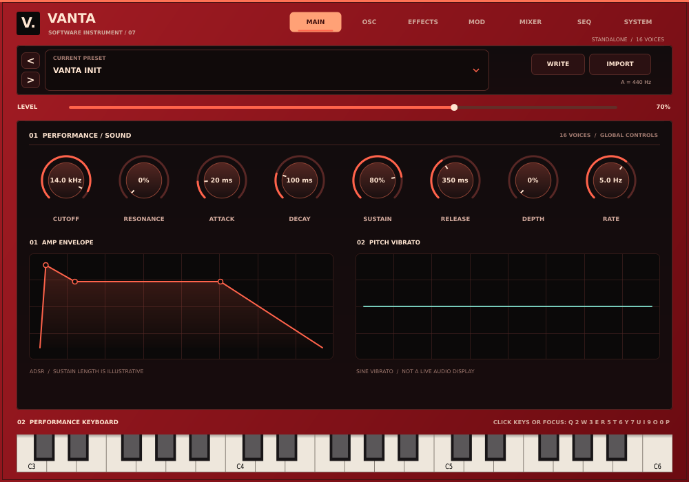

# Vanta Beta 0.7

VANTA is an experimental Windows x64 instrument, available as a VST3 for FL Studio and other hosts and as a standalone application. Beta 0.7 begins implementing the approved red-and-black design and adds real, layered oscillators. It is **not** yet a complete implementation of the planned feature list.



[View the oscillator page with four layers](docs/vanta-beta-0.7-oscillators.png). These are off-screen native-editor test snapshots; font rendering may differ on Windows.

## Install and play

The Windows build produces `Vanta-Beta-0.7-Setup.exe`, a standalone application and a VST3 bundle. The installer is unsigned. Back up DAW projects and uninstall earlier VANTA betas before installing this one: the betas use the same VST3 ID and duplicate bundles can confuse a plugin scan. Rescan plugins in FL Studio after installation.

Launch **Vanta > Vanta Beta 0.7** from the Start Menu. In the standalone window choose **Options > Audio/MIDI Settings...** to select an audio output and enable a MIDI input. Start with a low output volume. You can click the on-screen keys, or focus the keyboard and play:

`Q 2 W 3 E R 5 T 6 Y 7 U I 9 O 0 P`

These keys span C4–E5. The VST3 receives MIDI from the host; the standalone keyboard does not inject notes into a VST3 instance. Audio and MIDI device settings are controlled by your DAW when using the plugin.

## What's in Beta 0.7

- Up to **eight real oscillators** per note, with sine, saw, square or triangle shapes. OSC A is always present. On the **OSC** page, use **+ NEW TAB** to enable B–H, select a tab to change its waveform, level, semitone, fine tuning and pan, or **REMOVE** to disable a selected additional oscillator. Disabled layers retain their settings if re-enabled.
- The **MIXER** page provides enable switches for B–H, plus per-layer level and pan. All enabled oscillators share one low-pass filter, amplitude envelope, pitch vibrato and fixed effects chain. The layer mix is normalised when the sum of layer levels exceeds one to limit gain buildup. This is layered polyphony, not unison or independent per-layer filters/envelopes.
- Sixteen-voice polyphony, MIDI velocity, sustain pedal and pitch bend (fixed at ±2 semitones); master level, global low-pass cutoff/resonance, ADSR amplitude envelope and sine pitch vibrato.
- Reverb, delay and distortion, in a fixed order. The **MAIN**, **OSC**, **EFFECTS** and **MOD** plots illustrate parameter settings; they are not live audio meters.
- Five factory sounds with a searchable, category-filtered browser, plus native `.vanta` preset save/load and host-state restore. Oscillator settings are part of those presets and host state.
- The **SEQ** page illustrates the planned 32-step arpeggiator and 64-step clip sequencer. It is **not playable** in this beta. Extra oscillator engines, unison, general modulation routing/matrix, macros, reorderable/additional effects and advanced filters are also not implemented. See [the roadmap](design/windows-feature-roadmap.md).

The existing `wave` parameter and its original two-choice sine/saw mapping are retained for older host automation. OSC A square/triangle use an additional parameter; while either is selected, the old sine/saw parameter does not determine the audible shape until sine or saw is selected again. Old `.vanta` presets default the new layers to off. Host migration has automated coverage, but **has not been tested in FL Studio**; keep project backups.

## Preset compatibility

- **VANTA `.vanta`:** Native parameters, including layer settings, can be saved and loaded. Presets do not store audio files.
- **Vital `.vital`:** Experimental, partial **approximation**. Available amplitude envelope values and enabled filter-1 cutoff are mapped within VANTA's ranges, and a saw is substituted. Vital wavetables, samples, additional oscillators, envelope curves, modulation, filter models and effects are not imported; the sound will differ. A warning is shown.
- **Serum 1 `.fxp`, Serum 2 `.SerumPreset`, ZENOLOGY `.svz` / `.svd` / `.bin`:** Not implemented. Selecting one reports that it is unsupported and does not change the current sound.

Only import files you trust. Files larger than 32 MB are rejected. No third-party preset banks, wavetables or samples are included.

## Build and test on Windows

The GitHub Actions workflow builds both Windows formats, runs engine/preset/editor tests, creates the Inno Setup installer, and smoke-tests install, standalone launch, shortcut and uninstall on a disposable Windows runner. The artifact includes editor preview PNGs. This does **not** test a real audio device, MIDI hardware or FL Studio.

For a local build, install Visual Studio C++ tools, CMake 3.22+ and Inno Setup 6:

```powershell
cmake -S . -B build -A x64
cmake --build build --config Release --target VantaTests --parallel
cmake --build build --config Release --target VantaEditorTests --parallel
ctest --test-dir build -C Release --output-on-failure
cmake --build build --config Release --target VantaBeta_VST3 --parallel
cmake --build build --config Release --target VantaBeta_Standalone --parallel
& "${env:ProgramFiles(x86)}\Inno Setup 6\ISCC.exe" installer.iss
```

The installer defaults to `C:\Program Files\Vanta\Vanta Beta 0.7` for the app and the standard `C:\Program Files\Common Files\VST3` for the VST3 bundle. Uninstall removes the app, plugin and shortcut, not your saved presets. After installation, test audio/MIDI devices, keyboard, preset round-trip and DAW project save/reopen. Review JUCE and any third-party licensing obligations before distribution.
