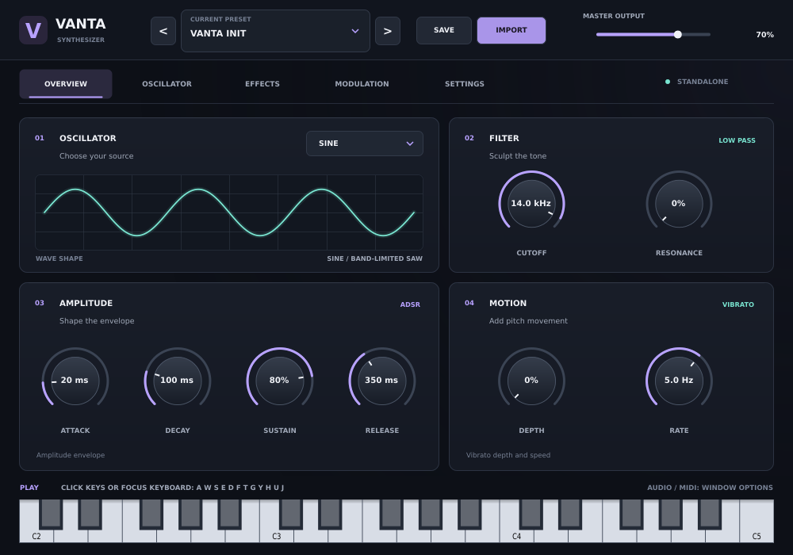

# Vanta Beta 0.6

VANTA is an experimental Windows x64 instrument available both as a VST3 for
FL Studio and other hosts and as a standalone application that does not need a
DAW. Beta 0.6 introduces a new native JUCE interface with a focused overview,
dedicated sound-editing pages, and a factory preset browser. This beta is a
fresh foundation, **not** a finished recreation of other synths.



The screenshot is an off-screen rendering of the actual editor; system fonts and
the application window frame may look slightly different on Windows.

## Using the standalone application

After installing, launch **Vanta > Vanta Beta 0.6** from the Windows Start Menu.
In the window's **Options > Audio/MIDI Settings...** menu, select an audio
output and enable your MIDI input device. These are separate from FL Studio's
audio and MIDI settings. Start with a low output volume.

You can also click the piano keys at the bottom of the standalone window. Click
the keyboard to give it focus and play with your computer keys (starting with
A, W, S, E, D, F, T, G, Y, H, U, J). Click it again if a control takes focus.
The standalone and VST3 use the same synth and `.vanta` preset format. The JUCE
standalone wrapper saves its own audio/MIDI settings and current sound on normal
exit; it does not change a VST3 instance's settings or FL Studio projects.

## Finding your way around

- Click the current preset at the top to browse the five factory sounds. The
  arrows step through them; **SAVE** writes `.vanta` files and **IMPORT** opens
  supported files.
- **Overview** brings together waveform, filter, amplitude envelope, vibrato,
  and master output. The **Oscillator**, **Effects**, and **Modulation** pages
  provide their dedicated controls; **Settings** describes device and preset
  support. Drag a knob to change it, or double-click it to reset it.
- The waveform and modulation graphs illustrate the current settings; they are
  not live audio meters. The envelope graph uses an illustrative sustain length.

## What works

- 16-voice polyphony; sine and band-limited saw; MIDI velocity, sustain pedal,
  and pitch bend (fixed at +/- 2 semitones).
- Master level, low-pass cutoff/resonance, amplitude ADSR and vibrato.
- Reverb, delay and distortion; their controls affect the audio.
- Five small VANTA factory sounds, plus saving and opening `.vanta` preset files.
- Saving and restoring plugin parameter state in the host. The Beta 0.3 plugin
  ID and its four parameter IDs are retained, but migration has **not yet been
  tested in FL Studio**. Back up your projects before trying it.

The Oscillator page exposes one oscillator. Extra oscillators/partials, unison,
legato, portamento, UI scale and advanced modulation routing are not implemented
and are not presented as working controls.

## Preset compatibility

- **VANTA `.vanta`:** Native parameter presets can be written and opened with
  the buttons in the plugin. These store the VANTA parameters, not audio files.
- **Vital `.vital`:** Experimental, partial **approximation** only. It imports
  available amplitude envelope attack/decay/sustain/release and filter-1 cutoff
  when that filter is enabled, with values clamped to VANTA's ranges. VANTA uses
  a saw oscillator; Vital wavetables, samples, additional oscillators, envelope
  curves, modulation, filter models and effects are not imported. The resulting
  sound will usually be different. The importer displays a warning each time.
- **Serum 1 `.fxp`, Serum 2 `.SerumPreset`, and ZENOLOGY `.svz` / `.svd` /
  `.bin`:** Not implemented. Selecting one reports that it is unsupported and
  leaves the current sound unchanged. Their preset formats and synthesis engines
  are different; future work needs format-specific research, legally obtained
  example presets and comparison against the original instruments.

Only import files you trust. VANTA does not modify imported files. Preset files
larger than 32 MB are rejected. No third-party preset banks, wavetables or samples
are included.

## Build and test on Windows

The GitHub Actions workflow **Build Windows VST3 and Standalone** runs engine,
preset and editor tests, builds both formats and the unsigned Inno Setup installer,
and checks install, standalone window launch, shortcut, and uninstall on a
disposable Windows runner. The artifact includes actual editor preview PNGs.
The smoke test compares installed files with the build; it does **not** test real
audio/MIDI hardware or FL Studio. Download the
`Vanta-Beta-0.6-Windows` artifact from a successful run on the branch containing
this version.

For a local build, install Visual Studio C++ tools, CMake 3.22+ and Inno Setup 6:

```powershell
cmake -S . -B build -A x64
cmake --build build --config Release --target VantaTests --parallel
cmake --build build --config Release --target VantaEditorTests --parallel
ctest --test-dir build -C Release --output-on-failure
cmake --build build --config Release --target VantaBeta_VST3 --parallel
cmake --build build --config Release --target VantaBeta_Standalone --parallel
& "${env:ProgramFiles(x86)}\Inno Setup 6\ISCC.exe" installer.iss
```

The unsigned installer is `installer-output\Vanta-Beta-0.6-Setup.exe`. By default
it installs the standalone application in `C:\Program Files\Vanta\Vanta Beta 0.6`,
adds its Start Menu shortcut, and installs the complete VST3 bundle under
`C:\Program Files\Common Files\VST3`. The app location can be changed in setup;
the VST3 location stays the Windows standard. Uninstall removes both formats and
the shortcut, not your saved preset files.

Back up FL Studio projects first; uninstall older VANTA betas before installing
this one to avoid two bundles with the same VST3 ID, then rescan plugins in FL
Studio. Test the standalone output and MIDI devices, on-screen keyboard, preset
round-trip, and your DAW's project save/reopen. Do not distribute before reviewing
JUCE's licensing and any third-party licensing obligations.
