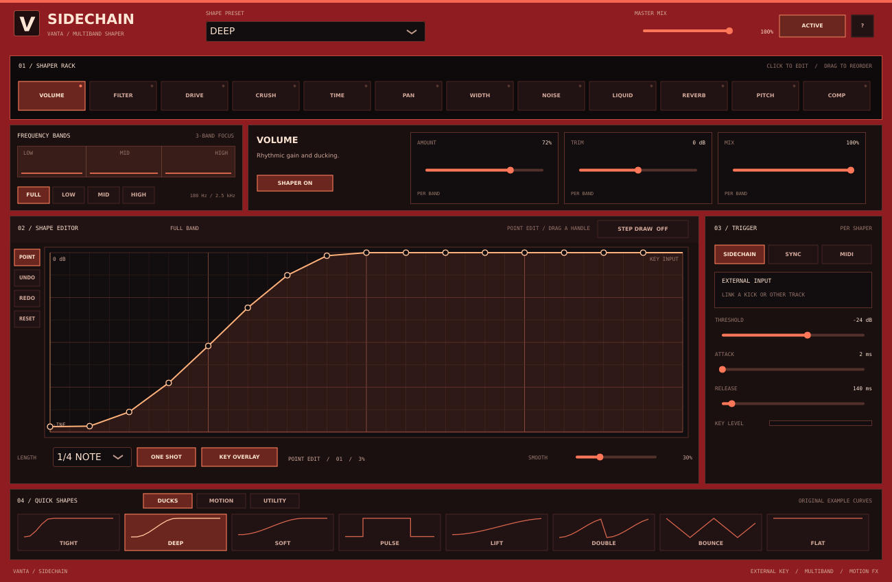

# VANTA Sidechain 0.1

VANTA Sidechain is an independent Windows x64 VST3 audio effect. Put it on the mixer track you want to shape: it is not part of the VANTA synth or Laggify. It has an actual external audio-key input, plus host-tempo and MIDI-note trigger modes. The VANTA Suite setup installs it together with the VANTA 0.13 instrument/standalone and the separate Laggify 0.2 effect.



The image is an off-screen native-editor test snapshot; host window framing and fonts can differ.

## Quick start in FL Studio

1. Back up your project, close the DAW, install the suite, then rescan VST3 plugins. Load **VANTA Sidechain** on the destination mixer track, such as your bass. Start at a low listening level.
2. Select the source mixer track, such as your kick. Right-click the routing arrow on the bass track and choose **Sidechain to this track**. That creates a key send without an ordinary audible send.
3. Open the effect's FL wrapper **Settings → Processing** page. If FL has not automatically connected it, enable/map the plugin's **Sidechain** input to the routed kick. The exact wrapper labels vary by FL Studio version.
4. In the plugin choose **VOLUME**, leave **SHAPER ON** and **SIDECHAIN** selected, and play the project. The key-level meter should respond to the kick. Lower **THRESHOLD** until the kick triggers the curve. The default curve ducks and rises back up; change **AMOUNT**, the graph, or **LENGTH** to taste.

A silent key, disabled/incorrect wrapper mapping or threshold set above the key level will not trigger ducking. The default volume curve passes the bass unchanged until it receives a trigger; custom curves and other effects can still colour audio. This routing is based on the FL Studio wrapper's sidechain workflow; the plugin has been exercised in a VST3 test host, but **has not yet been tested in FL Studio**.

## Controls

- Select a shaper in the rack, switch it on with **SHAPER ON/OFF**, and drag rack buttons to change processing order. Only Volume is enabled by default. Master **ACTIVE** and **MASTER MIX** apply to the entire effect.
- Choose **FULL** for full-range processing, or choose **LOW**, **MID** or **HIGH** to enable the three-band split and edit that band's own curve and controls. All three bands are processed and recombined in multiband mode; the fixed crossovers are approximately 180 Hz and 2.5 kHz. Each shaper keeps independent full/low/mid/high settings.
- Drag points to edit the curve. **STEP DRAW** turns on direct 16-step drawing: click/drag across the graph to draw multiple held steps. Turn it off again to return to point editing **without erasing the drawn shape**. Arrow keys select/adjust a point (Shift makes larger changes); undo/redo are per shaper and band. **RESET** restores that shaper's default curve.
- The **DUCKS**, **MOTION** and **UTILITY** banks and the top menu load original example *shapes for the selected band*, not complete rack presets. Edited shapes, parameters, rack order and window size are saved with your DAW project. The plugin does not currently manage user preset files.
- **SIDECHAIN** retriggers on the external key crossing the threshold; **ATTACK** and **RELEASE** smooth the detector and control when it can rearm. **MIDI** retriggers on note-on. **SYNC** follows host tempo/beat position while playing, or runs at host tempo when position is unavailable. For external/MIDI triggers, **ONE SHOT** plays the curve once; switching it off loops after the first trigger. **SMOOTH** softens the curve transitions. **KEY OVERLAY** shows a recent key-level trace; it is a visual aid, not a waveform recorder.
- Click the **V** logo for the resize menu. Resizing also depends on the host accepting the requested window size.

The twelve original modules are Volume, Filter, Drive, Crush, Time, Pan, Width, Noise, Liquid, Reverb, Pitch and Compressor. They are practical simplified effects, not ShaperBox or other products' algorithms or preset banks. Time uses a short modulated delay, Pitch uses small overlapping delay grains, Liquid is a simple phase-like effect, and Reverb is a short stereo feedback network. Their sound, latency/character and control ranges differ from commercial products; extreme settings can sound rough. The compressor uses the destination audio for its gain detector; the external key triggers its shape.

## Build and test

```powershell
cmake -S "Sidechain VST Effect" -B build/sidechain -A x64
cmake --build build/sidechain --config Release --target SidechainEngineTests SidechainProcessorTests SidechainVST3Tests --parallel 2
ctest --test-dir build/sidechain -C Release --output-on-failure
```

`SidechainVST3Tests` builds and loads the real VST3, activates the auxiliary key input and verifies ducking, automation, state and editor sizing. Other tests cover the DSP, MIDI offsets, state and native controls. These are automated test hosts, not real FL Studio, physical MIDI or audio-device tests. Review the JUCE and VST3 licensing notices in the installed `Laggify-third-party-notices.md` and `third-party` folder (or in the repository's [third-party notices](../Laggify%20VST%20Effect/THIRD_PARTY_NOTICES.md)) before distribution.
